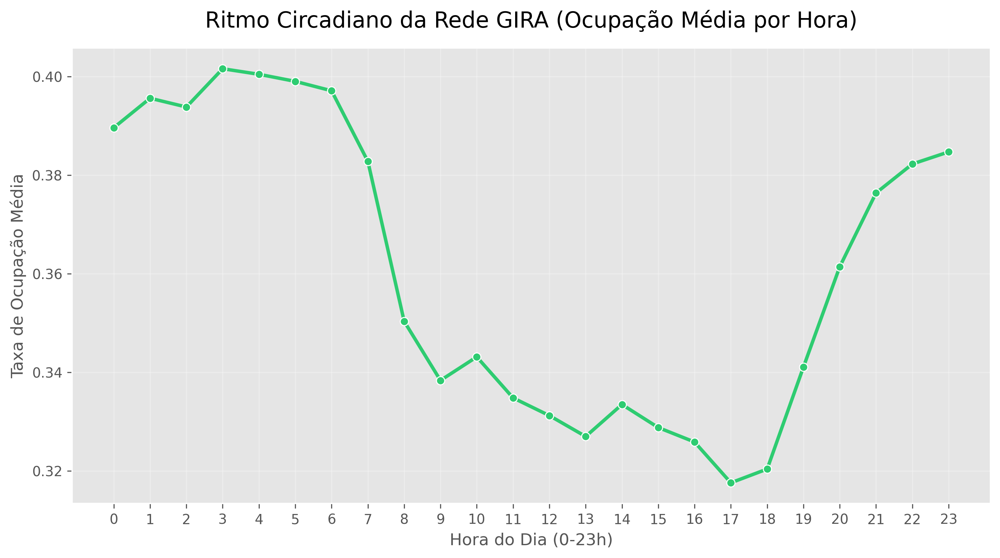
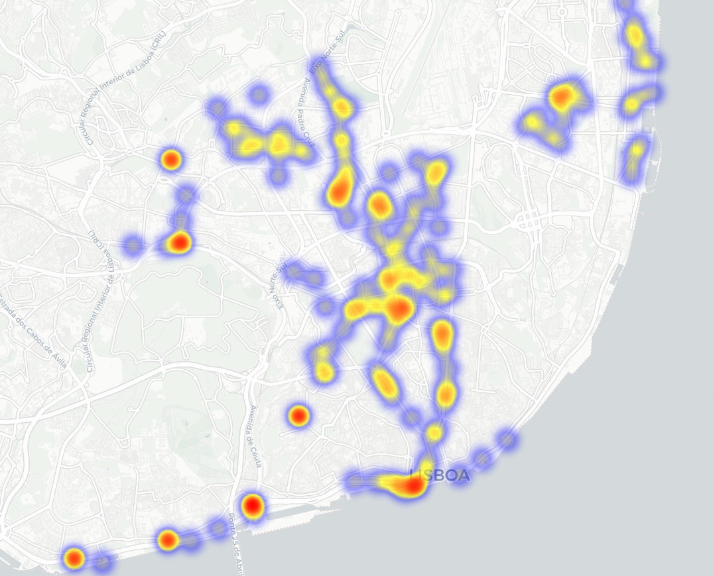

# 🚲 Lisboa Mobility Pulse: Otimização da Rede GIRA

**Um projeto End-to-End de Data Analytics e Engenharia focado na otimização logística da rede de micro-mobilidade de Lisboa.**

---

## 📖 1. O Problema de Negócio (A Situação)
A GIRA (rede pública de bicicletas partilhadas de Lisboa gerida pela EMEL) enfrenta um desafio clássico de logística urbana, agravado pela topografia da cidade (as "Sete Colinas"). Durante os picos de movimento pendular (casa-trabalho), geram-se fortes desequilíbrios na frota:
* **Stockouts (Docas Vazias):** Zonas de alta procura ficam sem bicicletas, gerando frustração nos utilizadores e perda de receita.
* **Docas Cheias:** Zonas de destino ficam sem espaço para devolução, forçando o utilizador a desviar a rota.

**Objetivo:** Identificar os padrões temporais e geoespaciais dos *stockouts* para propor estratégias de rebalanceamento preditivo da frota.

---

## 🛠️ 2. Stack Tecnológica e Metodologia (A Tarefa e Ação)
Este projeto processou mais de **933.000 registos** (1º Trimestre de 2023) através de um pipeline robusto e modular.

* **Linguagem:** Python 3.10+
* **Data Engineering:** `pandas`, `openpyxl`, `pyarrow` (Conversão de Excel para `.parquet` visando performance de Big Data).
* **Feature Engineering:** Extração de coordenadas geográficas via **Expressões Regulares (Regex)** a partir de *stringified* JSON.
* **Análise Espacial & EDA:** `folium` (Heatmaps interativos) e `seaborn` (Análise de Séries Temporais).

---

## 📊 3. Principais Descobertas (O Resultado)

### O Ritmo Circadiano de Lisboa (Análise Temporal)
A análise à Taxa de Ocupação Média revela que a GIRA atua, primariamente, como uma ferramenta de *commuting* (movimento pendular):

* **O "Drain" Matinal (06h - 09h):** Queda vertiginosa na ocupação média. As bicicletas saem das docas residenciais em direção aos centros empresariais.
* **O Pico de Stress (17h - 18h):** É o momento crítico da operação, marcando a menor taxa de ocupação global do dia. O sistema atinge a sua capacidade máxima de utilização.

### Os "Desertos" de Mobilidade (Análise Geoespacial)
Ao mapearmos exclusivamente as instâncias de `0 bicicletas disponíveis`, o mapa de calor revela as artérias sob maior pressão logística:

*(Podes visualizar o mapa interativo completo baixando o ficheiro `outputs/maps/stockout_heatmap.html`)*

* **O Coração Empresarial:** Uma mancha crítica desde as Avenidas Novas até ao Marquês de Pombal (Saldanha). O fim do turno de trabalho esgota as docas quase instantaneamente.
* **O Efeito Ribeirinho e Plano:** Fortes focos de falha na faixa Cais do Sodré -> Belém e no Parque das Nações. A preferência por trajetos planos (sem elevação) causa uma alta rotação que a reposição manual não consegue acompanhar.

---

## 💡 4. Recomendações Estratégicas (Next Steps)
Para mitigar os *stockouts* sem escalar linearmente os custos com carrinhas de reposição, propõe-se:

1. **Implementação de "Nudge Theory" (Incentivos Dinâmicos):** * Gamificação na App: Oferecer minutos grátis ou descontos na subscrição a utilizadores que retirem bicicletas das zonas ribeirinhas (planas) e as devolvam nas docas das colinas durante as horas de vale (11h-15h).
2. **Reposição Preditiva:**
   * Alocar a frota de carrinhas de manutenção nas zonas do Saldanha e Parque das Nações impreterivelmente antes das 16:30, antecipando o choque de procura das 17h.
3. **Eletrificação Estratégica:**
   * Garantir que as docas nas bases das colinas são abastecidas com um rácio maior de e-Bikes, reduzindo a fricção do relevo.

---
*Projeto desenvolvido como demonstração de competências End-to-End em Data Analytics e Business Intelligence por Mário Prazeres.*